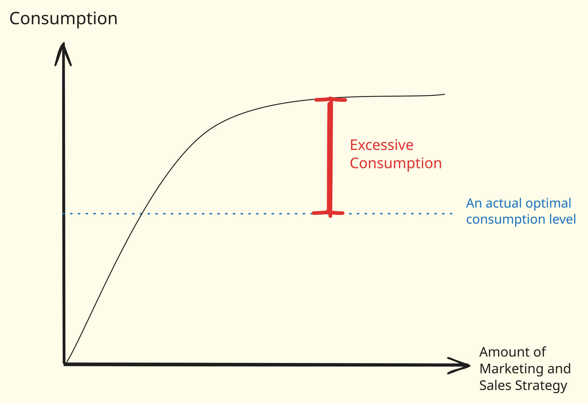
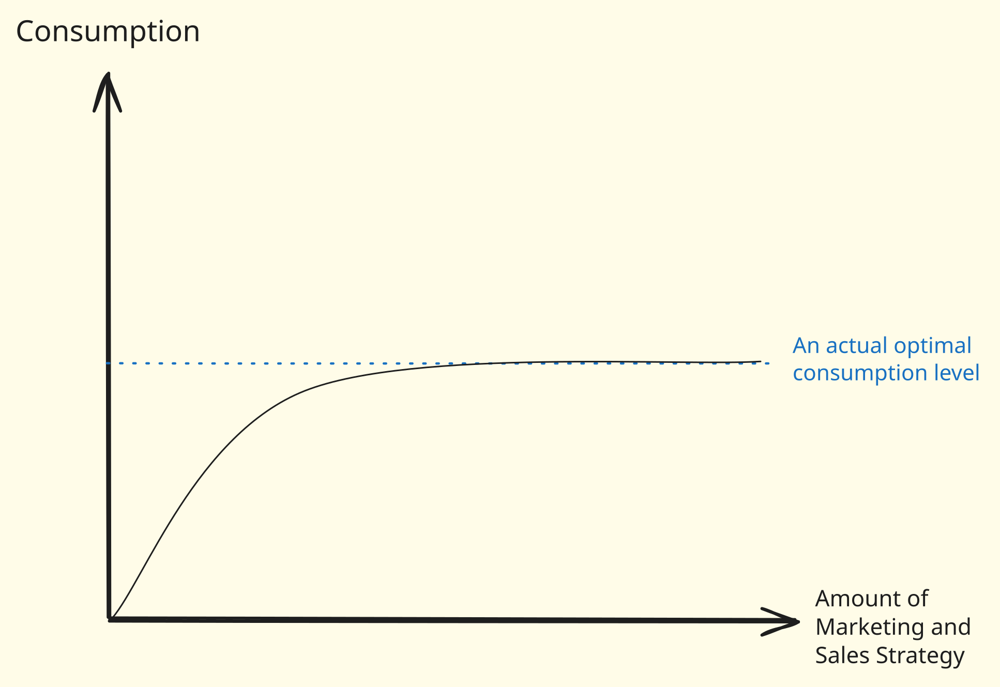
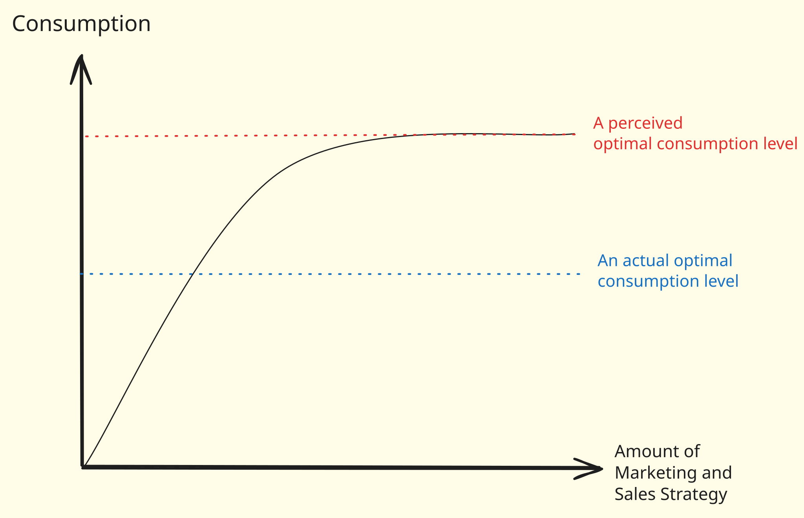

**Noted that this entire pieces*is not backed by any research*, it's purely my opinion and hypothesis just for fun.**

## What's a 'natural' process of buying things

The most straightforward and simplified process of buying things goes like this:
1. You think about what you want
2. Go to a store and find what you want
3. If it exists, buy it; if not, go home.
Inherently, the first step would either start with 'need' (e.g., food) or 'want' (e.g., you see your friend use new iPhone 67 pro max limited master ultimate edition and you think you want it) and both are fine, although the latter is somewhat of a marketing strategy used by money-hungry companies nowadays.

## Let's add some un-natural forces to it

If you are a money-hungry company and logically connect the dots, you will figure out that in order to boost sales, you only have to do one thing: Manipulate the first step, i.e., make consumers think they need your product, because the remaining steps are essentially just a response to organic demand, ensuring sufficient supply. This is exactly what a *marketing and sales strategies* are designed to do. Hence, the whole process is changed to:

1. Companies adopt marketing and sales strategies to convince you that you need their products.
2. You start thinking that this might actually be what you want.
3. Go to a store and find the one you want.
4. If it exists, buy it; if not, go home.

Note that we're ignoring *in-store sales strategy* such as find the exact shelf location that maximizes revenue for a particular product or product bundling and decoy pricing.

### The issue

Let's say that the optimal level of consumption is constant and people end up consuming excessively as a consequence.

Considering that people aren't too dumb to notice that they sometimes buy things they don't use which can be attributed to various reasons, such as:
* **Marketing and sales strategies keep proselytizing about the upsides of a product**. As a result, people have little awareness of its downsides and cannot determine whether those downsides are negligible enough to overlook, given their own preferences and context as a consequence.
* Sometimes, there's a **mismatch between the product capabilities that marketing communicates and the actual capabilities**. 
* **Marketing and sales strategies make you think that you need the capabilities a product offers**, but if you think about it more carefully, it actually doesn't matter at all, i.e., your quality of life hasn't actually improved.

### Consumers' response: Review

One safeguard that helps you avoid excessive purchases and second-guess yourself is to ask people who bought it about its pros, cons, and their experiences with it. The information you receive is both informative and persuasive. What I mean by that is since you think you want one thing, if the information prevents you from buying a thing that doesn't match with your wants or need, it's informative. But if the product actually suits your wants or needs, the information encourages you to buy such thing, it's persuasive.

Thus, this social/community-driven review system without any monetary incentives tied to sales (i.e., people kindly give, write, and post review solely for consumers' benefit, helping consumers buy meaningful things.) could theoretically reduce the excessive consumption to near zero, even with endless growth in the amount of marketing and sales activity involved, consumption would never go beyond an optimal level as the following figure shows:

### Companies' backlash: Affiliate Marketing

Companies hate this, actually. And they cannot wipe out reviews out of existence. Online reviews could potentially be wiped out, but offline reviews would still exist. So, they take a smarter approach by figuring out how to ***leverage*** the status quo, eventually figured out how to weaponize the persuasive nature of a reviews.

> What if we could fundamentally turn all reviewers into the company's marketers and salespeople?

By giving monetary incentives to those who measurably generate sales: *Affiliate Marketing*. Rather than removing reviews, this method makes the graph look even worse due to the *emergence of marketing troops* which results in a lack of *check-and-balance mechanism* as a consequence. The figure below demonstrates what I'm talking about: 

**Before the affiliate marketing model, the community has no predictable pattern in what people are going to say about something**, given the likelihood of appreciating something is somewhat random. What I'm trying to say is, when people like something, they simply say that they like it and explain why, and vice-versa. But in the affiliate marketing era, a predictable pattern emerges. Since people have an incentive to proselytize the upsides of a product, some make a 180-degree turn and essentially become the company's marketers to earn as much commission as possible (I understand that money is crucial for living, and for some people, it's the only way they can survive in this bullshit capitalist system that constantly forces them to do things they don't want to do just to make a living). Some stick to their principles and remain sincere (I really appreciate it), while others choose to strike a balance somewhere in between, which I think is what most people would go for.

Since the whole community is also somehow trying to sell the product, there are fewer independent sources of *checks-and-balances*, which makes **all products seem necessary, useful, and worth buying**. Therefore, from the consumer’s perspective, the perceived optimal level of consumption seems to increase. Although consumption remains at the same level as before all this, consumers would not second-guess themselves or feel uneasy at all because of a higher standard of consumption, which may lead to avoidable financial burdens.

## The Verdict

I have some personal opinion for what's going on. Affiliate marketing creates new jobs that are not regular, boring 9-to-5 jobs. This move could offer a glimmer of hope, motivation and a sense of purpose to someone who doesn't fit into a conventional job. On the other hand, it could also cause consumers to lose control of their finances, so try to be mindful.