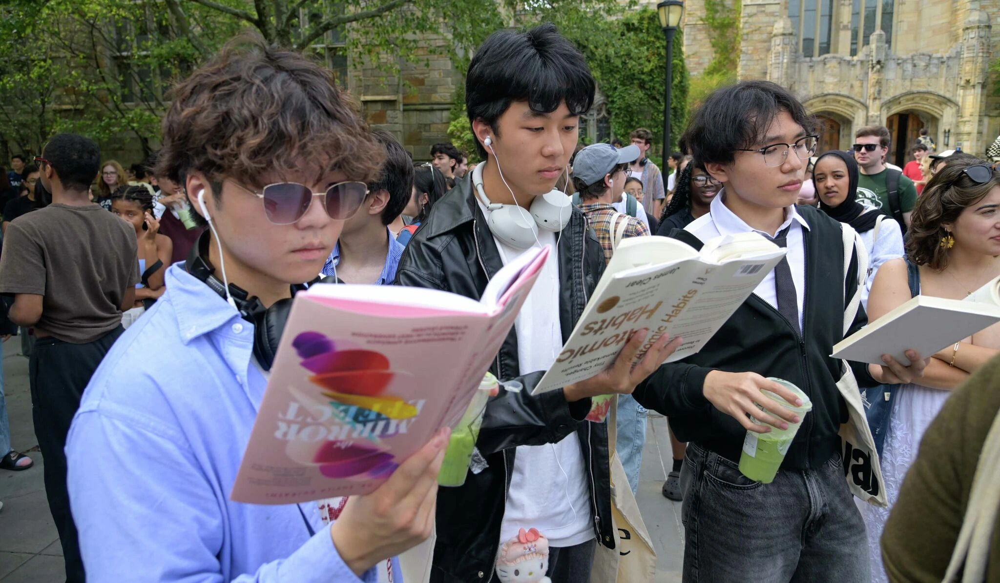

**I’m not born to be a bookworm**. In the past few years I entered a new hobby, reading , because it looks cool. Compared to other modern mediums, it is considered unsearchable, clunky, and takes up space. By that time, **I think the very benefits of books to other mediums is the quality of knowledge.** The idea is read by an editor, hence, vetted by people on top of the author. Which kinda like having a peer review (not a peer review in a sense which has a person who has relatively skill or knowledge with a particular field to author, yet in a sense which at least having someone read it before published) which online-based knowledge like YouTube videos or online articles merely has none. 

**As a consequence, I had been reading only non-fiction for a while and I felt like my hypothesis about books had collapsed.** The knowledge provided by the book can be a perfect counterpart to a YouTube video. For example, if a key message of the book is “Life is about happiness”, it’s all but impossible to have no single YouTube video, or an online article has a one-to-one equivalent key message. I was so confused about the worthiness of reading books. My logic is that **it’s not make any sense to acquire the same piece of knowledge with a less accessible medium.** I just didn’t understand this phenomenon.

After a while (I cannot remember when it happened), I saw a flaw in my logic. I just asked myself that if a piece of knowledge is the only considered factor used to choose a medium, then why is there a phenomenon which has 2 (or more) videos that have an identical key message and have different views count. Why do people choose to watch one over others, even though they are saying the same thing? I answer the question with 2 words, circumstances and arrangement . There are countless stories, examples, or even logical chains to derive or come up with ideas, circumstances, and also countless storylines to layout a book (or other mediums), arrangements. Since people have different backgrounds, interests, and values, hence, different circumstances and arrangements could significantly affect the probability that consumers’ would understand and accept the idea. **To conclude, people are not only seeking a particular piece of knowledge, yet seeking for circumstances and arrangements that make sense to them.** *In a condition with you're not performatively reading lol.*

##### *I hope this article is not weird lol. I tried to write down this entirely in Google Docs and not use AI to paraphrase my article, using just a native spelling and grammar check.*
